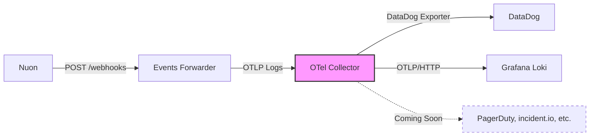

# Events Forwarder

## Overview

This app is an event forwarder that receives events from Nuon and forwards them to your observability platforms.



**Built with:**
- FastAPI for webhook endpoint
- OpenTelemetry Collector for platform routing

## Quick Start

**Prerequisites:**

- Deployment platform (this app uses Fly.io via `fly.toml`, but works anywhere Docker runs)
- A Nuon org with a configured webhook and signing secret ([Webhook Docs](https://docs.nuon.co/guides/webhooks#webhooks))

**Observability platforms** (current):
- DataDog (API key)
- Grafana Loki (Loki URL + Instance ID + API token)

> **Note:** Platforms are configured in `otel-collector/config.yaml`. To add or remove platforms, simply edit the exporters and pipelines.
>
> **Example - Adding a new platform:**
> ```yaml
> exporters:
>   # Add your new exporter
>   otlphttp/newplatform:
>     endpoint: https://your-platform.com/otlp
>     headers:
>       Authorization: "Bearer ${YOUR_API_TOKEN}"
>
> service:
>   pipelines:
>     logs:
>       exporters: [datadog, otlphttp/loki, otlphttp/newplatform]  # Add to list
> ```

## Architecture

**Simple flow:**
1. FastAPI app receives webhook from Nuon
2. `WebhookHandler` verifies signature and parses payload
3. Full webhook JSON forwarded to OTel Collector as log
4. OTel Collector routes to configured platforms

**Code example - WebhookHandler:**
```python
# src/webhook_handler.py
class WebhookHandler:
    def __init__(self):
        self.otel_client = OtelClient()
    
    async def process_webhook(self, request: Request) -> dict:
        # 1. Verify signature
        if not self._verify_signature(raw_body, signature):
            raise HTTPException(status_code=401)
        
        # 2. Parse webhook
        webhook = NuonWebhook(**payload_dict)
        
        # 3. Forward to OTel Collector
        await self.otel_client.send(webhook)
```

**Code example - OTel Collector config:**
```yaml
# otel-collector/config.yaml
service:
  pipelines:
    logs:
      receivers: [otlp]           # Receives from app
      processors: [batch]          # Batches logs
      exporters: [datadog, otlphttp/loki]  # Routes to platforms
```

## Local Development

Running the Events Forwarder locally is straightforward with Docker Compose.

**Prerequisites:**
- Docker and Docker Compose installed

**Setup:**

1. Copy `.env.example` to `.env` and fill in your credentials

2. Start the services:
```bash
docker-compose up
```

This starts two services:
- **app** - FastAPI webhook receiver on `localhost:8080`
- **otel-collector** - OpenTelemetry Collector on `localhost:4318`

**Exposing locally for webhook testing:**

To receive real webhooks from Nuon, expose your local environment with Tailscale Funnel or any similar tunneling tool.

## References

**Platform Documentation:**

| Platform | Link |
|----------|------|
| Nuon Webhooks | [docs.nuon.co](https://docs.nuon.co/guides/webhooks#webhooks) |
| DataDog | [docs.datadoghq.com](https://docs.datadoghq.com/) |
| Grafana Cloud | [grafana.com/docs](https://grafana.com/docs/grafana-cloud/) |

**Technical Specifications:**

| Technology | Link |
|------------|------|
| OpenTelemetry Collector | [opentelemetry.io/docs/collector](https://opentelemetry.io/docs/collector/) |
| OTLP Protocol | [opentelemetry.io/docs/specs/otel/protocol](https://opentelemetry.io/docs/specs/otel/protocol/) |
| FastAPI | [fastapi.tiangolo.com](https://fastapi.tiangolo.com/) |