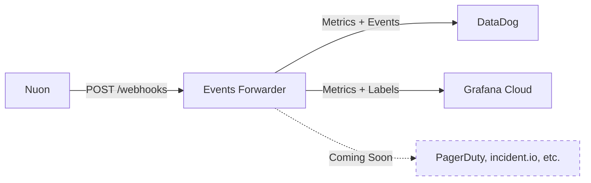

# Events Forwarder

## Overview

This app is an event forwarder that receives events from Nuon and forwards them to your observability platforms.



**Built with:**
- FastAPI for webhook endpoint
- Prometheus Remote Write (Protobuf + Snappy) for Grafana
- Forward-only architecture (no parsing, works with all webhook types)

## Quick Start

**Prerequisites:**

- Deployment platform (this app uses Fly.io via `fly.toml`, but works anywhere Docker runs)
- A Nuon org with a configured webhook and signing secret ([Webhook Docs](https://docs.nuon.co/guides/webhooks#webhooks))

**Observability platforms** (current):
- DataDog (API key + App key)
- Grafana Cloud (Metrics URL + Instance ID + API token)

> **Note:** You can disable platforms you don't use by not setting their credentials. New integrations can be added following the subpackage pattern:
> ```
> src/integrations/
> ├── datadog/         # Current
> ├── grafana/         # Current
> ├── pagerduty/       # Coming soon
> ├── incident_io/     # Coming soon
> └── your_platform/   # Add your own
> ```

## Architecture

All integrations use a shared helper to extract metadata from webhooks. This keeps the extraction logic in one place:

```python
# src/integrations/utils.py
def extract_metadata(webhook: NuonWebhook) -> Dict[str, str]:
    metadata = {
        "source": "nuon",
        "kind": webhook.nuonkind,
        "workflow_id": webhook.data.workflow.id,
        "install_id": webhook.data.workflow.owner_id,
        # ... all metadata fields
    }
    
    # Add step-specific metadata if available
    if webhook.data.step:
        metadata["step_id"] = webhook.data.step.id
        metadata["step_name"] = webhook.data.step.name
        # ...
    
    return metadata
```

### Integration Pattern

Each integration formats the metadata for its platform:

```python
# DataDog - formats as tags (list of "key:value" strings)
metadata = extract_metadata(webhook)
tags = [f"{key}:{value}" for key, value in metadata.items()]
# Result: ["source:nuon", "kind:workflow", "workflow_id:abc123", ...]

# Grafana - uses metadata directly as labels (dict)
labels = extract_metadata(webhook)
# Result: {"source": "nuon", "kind": "workflow", "workflow_id": "abc123", ...}
```

## References

**Platform Documentation:**

| Platform | Link |
|----------|------|
| Nuon Webhooks | [docs.nuon.co](https://docs.nuon.co/guides/webhooks#webhooks) |
| DataDog API Keys | [docs.datadoghq.com](https://docs.datadoghq.com/account_management/api-app-keys/) |
| Grafana Cloud | [grafana.com/docs](https://grafana.com/docs/grafana-cloud/) |

**Technical Specifications:**

| Technology | Link |
|------------|------|
| Prometheus Remote Write 2.0 | [prometheus.io](https://prometheus.io/docs/specs/prw/remote_write_spec_2_0/) |
| Protocol Buffers | [protobuf.dev](https://protobuf.dev/) |
| Snappy Compression | [google.github.io/snappy](https://google.github.io/snappy/) |
| FastAPI | [fastapi.tiangolo.com](https://fastapi.tiangolo.com/) |